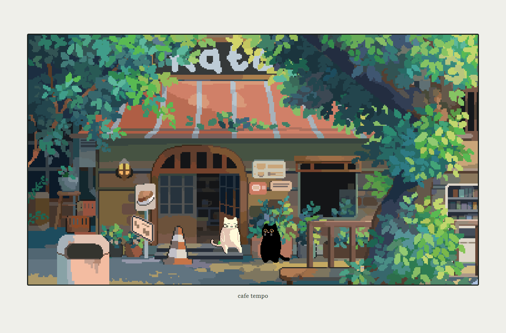
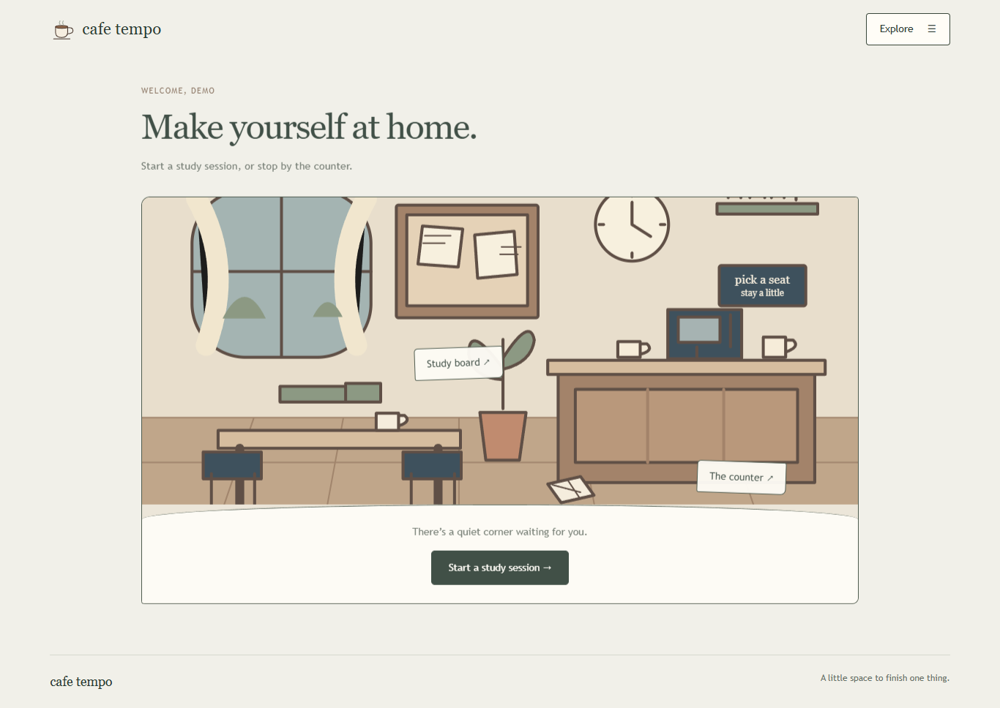
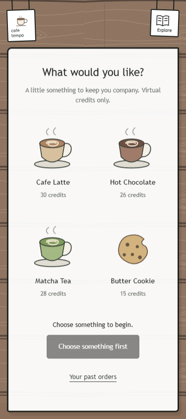

# Cafe Tempo · working UI draft

A virtual study cafe built with React, Vite, TypeScript, Tailwind CSS, React Router, React Hook Form, Zod, and axios. This draft connects to the Express API and MongoDB Atlas; its artwork is temporary and easy to replace.

## Start the application

Open two PowerShell terminals. In the first:

```powershell
cd C:\Users\mjfer\cafe-tempo\server
npm.cmd install
npm.cmd run seed
npm.cmd run dev
```

Keep your Atlas connection string in the server's private `.env`. In the second terminal:

```powershell
cd C:\Users\mjfer\cafe-tempo\client
npm.cmd install
npm.cmd run dev
```

Open **http://localhost:5173**. Use `localhost` so it matches the server's default CORS origin. The client defaults to `http://localhost:5000/api`. To change that address, copy `.env.example` to `.env` and edit `VITE_API_URL`; restart Vite afterward. Client environment variables are public, so never put database credentials here.

Click the animated cafe entrance (hover or focus to see **ready to lock in?**), choose **Demo Student**, then choose a drink, its size, a name or label, and a task. The notepad prepares your session; **Start session** on the focus page takes a seat and starts the timer. Use **Explore** to reach the study board, spaces, counter, reservations and notebook. Profile selection is not authentication. The existing backend has no password login; authentication is optional under the rubric and has not been implemented.

## What the draft supports

- Create, edit, complete, filter, and delete tasks; display server-calculated priority.
- Explore five cafe areas, check availability, reserve a seat, and cancel a reservation.
- Prepare a session through drink selection (Tall 25, Grande 45, Venti 60 minutes), a label, and a task notepad. Smart focus recommendation remains available through Explore.
- Start, pause, resume, stop, and reload sessions using server timestamps. Stopping saves elapsed whole minutes; sessions under one minute are cancelled.
- Browse the five spaces with arrows; explicitly reserve a different seat while running. Full areas are blocked by the server. Pausing releases the seat; resuming checks capacity again.
- Music playback and volume controls are wired; the audio file will be added later.
- Run a countdown from the persisted session start time and show the recommended break after completion.
- Select drinks and snacks, preview server-calculated totals/discounts, place an order, view order history, and cancel an order.
- Read productivity statistics, current streak, longest streak, favorite area, and most ordered drink.
- Recover from failed requests and show validation, empty, loading, and success states.

The updated flow and instructions for adding music are in [docs/STUDY_FLOW.md](docs/STUDY_FLOW.md).

There are 21 page routes, with a shared component for the add/edit task form. The endpoint map is in [docs/DRAFT_PLAN.md](docs/DRAFT_PLAN.md). The simplified flow and handoff are in [docs/REDESIGN.md](docs/REDESIGN.md), with an optional [asset brief](docs/ASSET_BRIEF.md).

## Structure for the frontend handoff

```text
src/
  api/http.ts           axios instance and API error messages
  services/cafeApi.ts   typed endpoint calls
  hooks/                request loading/retry and timer logic
  state/CafeContext.tsx profile selection, basket, and success notices
  schemas/forms.ts      external Zod schemas and inferred form types
  utils/dates.ts        date display and API date conversion
  types.ts              API response types
  components/           navigation, cafe scene, and reusable form/state UI
  pages/                screen layout and user interactions
  assets.ts             replaceable artwork paths
  styles.css            custom Tailwind theme and draft styling
public/                 original temporary SVG illustrations
```

The server owns prices, discounts, recommendations, priority scores, seat counts, and statistics. The browser owns navigation, display, selected item quantities, and the countdown. Changing artwork or layout does not require rewriting endpoint calls. Reuse the services and hooks when your partner refines the components.

## Verification

```powershell
npm.cmd run build
npm.cmd run test:e2e
npm.cmd run screenshots
```

The browser tests require Chrome, the running API, and the server folder at `../server`. For a different location, set `$env:TEMPO_SERVER_DIR` to that folder before testing. Tests create an isolated profile and delete only its temporary records afterward. Playwright is a development verification tool, not part of the application's runtime.

The tests exercise the full drink/notepad flow, pause persistence, seat changes, simultaneous capacity requests, task creation/editing/deletion, focus persistence/completion, the same-day discount, order placement/cancellation, seat reservation/cancellation, analytics, API failures/retry, and 375px page widths. Screenshots from the checks are saved in `docs/screenshots/`.





## Scope and remaining work

Visual inspiration: [cafe.pauwee.com](https://cafe.pauwee.com/). The draft uses its entrance and drink-selection flow as inspiration, with original temporary SVG assets, quiet transitions, and object-based navigation for Cafe Tempo. It does not copy the reference assets.

- Final illustration, typography, and interaction polish belong to the frontend refinement step.
- Focus Passport achievements and password authentication have not been added.
- A session does not automatically mark its task completed; update the task when its work is finished.
- The draft saves elapsed whole minutes from the server clock. A timer reaching zero asks you to stop and save; it does not send background notifications.
- This is a shared demo profile, not a secure account boundary. Do not use it for private multi-user data.
- Add the frontend partner's confirmed name and contribution summary before submission. Backend author: Jan Matthew Ferreras. Every group member needs their own meaningful commits.

Server repository: <https://github.com/ferrerasjan/tempo-server>. Client repository: <https://github.com/ferrerasjan/tempo-client>.
